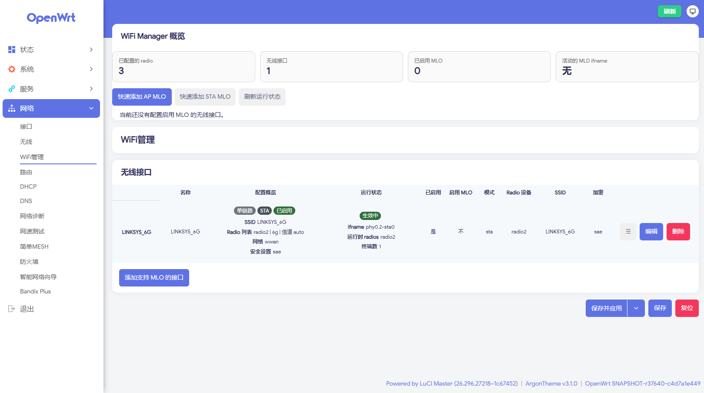

**English** | [简体中文](README.md)

# luci-app-wifimanager

A **WiFi Manager** page under LuCI's Network menu for managing Wi-Fi MLO (Multi-Link Operation,
Wi-Fi 7 / 802.11be) interfaces.



## Installation

> The version number in the package name must match `PKG_VERSION` / `PKG_RELEASE` in the
> [Makefile](Makefile) (currently `1.0.0-r1`).

**Minimum supported: OpenWrt / ImmortalWrt 24.10** (earlier versions are not supported).

opkg (OpenWrt / ImmortalWrt 24.10 and earlier):

```bash
opkg install luci-app-wifimanager-*.ipk
```

apk (OpenWrt / ImmortalWrt 25.12+):

```bash
apk add --allow-untrusted luci-app-wifimanager-*.apk
```

The Simplified Chinese UI requires a **separately installed** translation package — the main
package ships no translations, so the UI stays in English without it:

```bash
opkg install luci-i18n-wifimanager-zh-cn*.ipk                 # 24.10 and earlier
apk add --allow-untrusted luci-i18n-wifimanager-zh-cn*.apk    # 25.12+
```

### Build from source

```sh
cd openwrt
./scripts/feeds update -a
./scripts/feeds install -a
git clone https://github.com/Arthur97172/luci-app-wifimanager.git package/luci-app-wifimanager
make menuconfig   # LuCI -> Applications -> luci-app-wifimanager
make package/luci-app-wifimanager/compile V=s
```

Output: `luci-app-wifimanager_1.0.0-r1_all.ipk`.

## Where it lives

**LuCI → Network → WiFi Manager**

- **Overview** — number of configured radios, wireless interfaces and MLO-enabled
  interfaces, plus warnings (fewer than two radios, an MLO interface with too few radios,
  a custom ifname overriding the generated name, …).
- **Quick Add** — `Quick Add AP MLO` / `Quick Add STA MLO` create a working MLO interface
  in one click, defaulting to WPA3-SAE with Management Frame Protection required, the most
  compatible starting point in this tree.
- **Interface list** — one row per `wifi-iface`, with two read-only columns: `Profile`
  (summary) and `Runtime` (live state, refreshed every 5 seconds).

Clicking a row opens the editor, which has three tabs:

- **General** — Enabled, Enable MLO, Mode (ap / sta / adhoc / mesh), Radio devices (multi-select),
  Attached network(s), SSID, Hide SSID
- **Security** — Encryption, Passphrase, 802.11w Management Frame Protection
- **Advanced** — Interface name, MAC address, BSSID, WDS / 4-address mode, U-APSD, OCV,
  Disassociate on low ACK

## The problem it solves

In OpenWrt an MLO interface is a `wifi-iface` carrying `mlo=1` whose `device` list names
**two or more** radios. The driver aggregates those radios into one MLD (multi-link
device) and auto-generates an interface name such as `ap-mld0` / `sta-mld0`. Hand-writing
that UCI is easy to get wrong, so this package provides a dedicated page.

## Things worth knowing

- **MLO needs at least two radios.** With fewer, the page says so plainly and Quick Add
  refuses to create anything.
- **The 802.11w default is never written to the config.** The default is derived from the
  encryption mode (SAE / OWE → required, sae-mixed → optional, anything else → disabled);
  when the value equals that default, no `ieee80211w` is written, so a psk2 interface does
  not silently gain PMF and lock out clients that do not support it.
- **`ssid` and `wds` carry no conditional visibility.** Both are meaningful for ap and sta
  alike, and LuCI deletes an option that is not currently visible when the form is saved —
  so a tautological `depends` would cost an interface whose mode is outside {ap, sta}
  (the stock wireless page also offers adhoc) its `ssid` on an unrelated save.
- This page offers `ap`, `sta`, `adhoc`, and `mesh`; use the stock wireless page for other modes.

## Dependencies

- `luci-base` — the page's modules and the menu parent; pulls in `rpcd-mod-luci`, which
  provides the `luci-rpc` ubus object
- `rpcd-mod-iwinfo` — the runtime column reads associated stations via `iwinfo.assoclist`

## Tests

Plain `node` scripts, no dependencies:

```sh
node tests/i18n.test.js       # translations vs the _() literals in the source
node tests/view.test.js       # really loads the view module in a mini-DOM sandbox
node tests/mutation.test.js   # re-injects each fixed bug to prove the assertions bite
```

The `form` / `uci` doubles in `view.test.js` are written line by line against luci-base's
`form.js` and `uci.js`; keep that fidelity when you touch them, or assertions will start
passing for the wrong reason.

## License

GPL-3.0-only, see [LICENSE](LICENSE).
